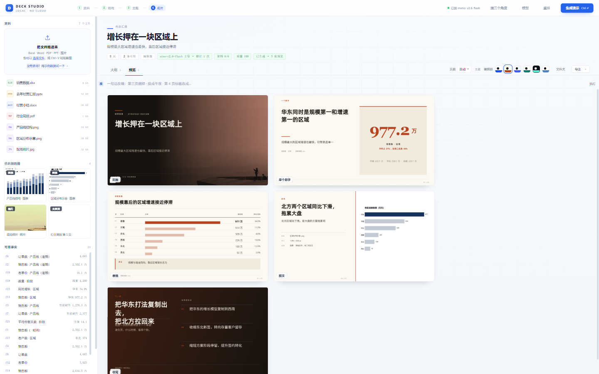
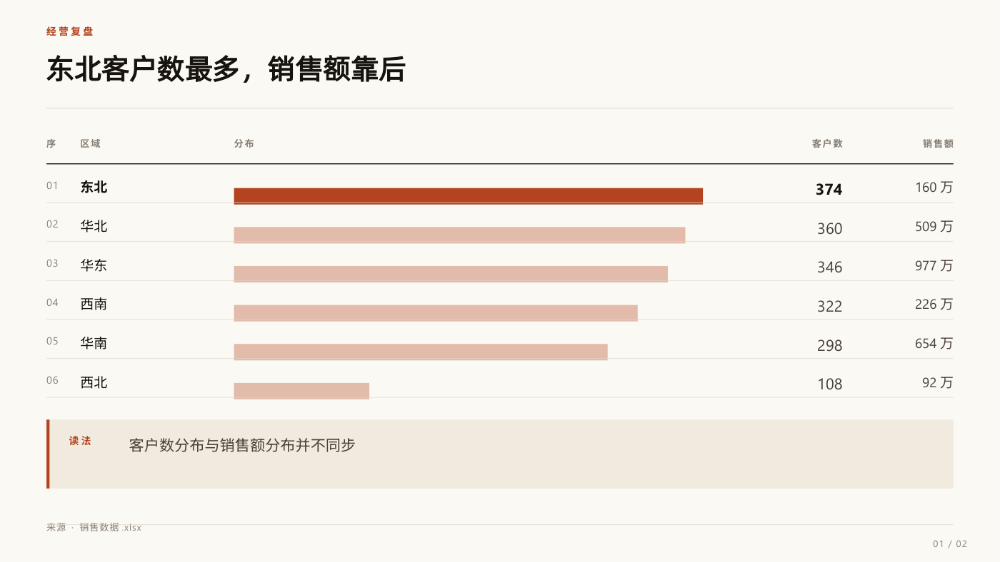
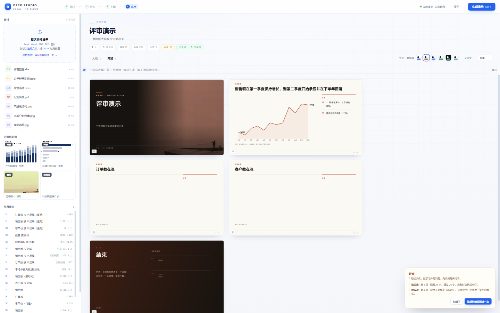
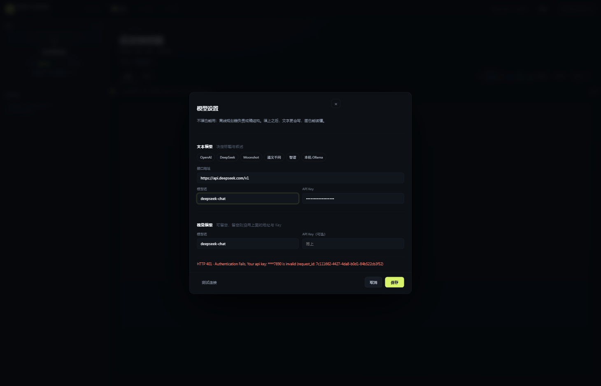
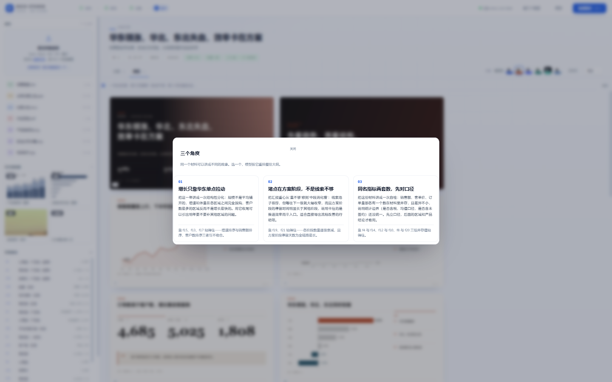
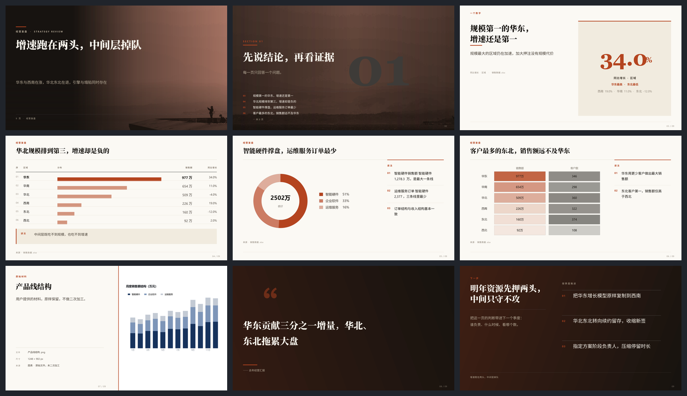
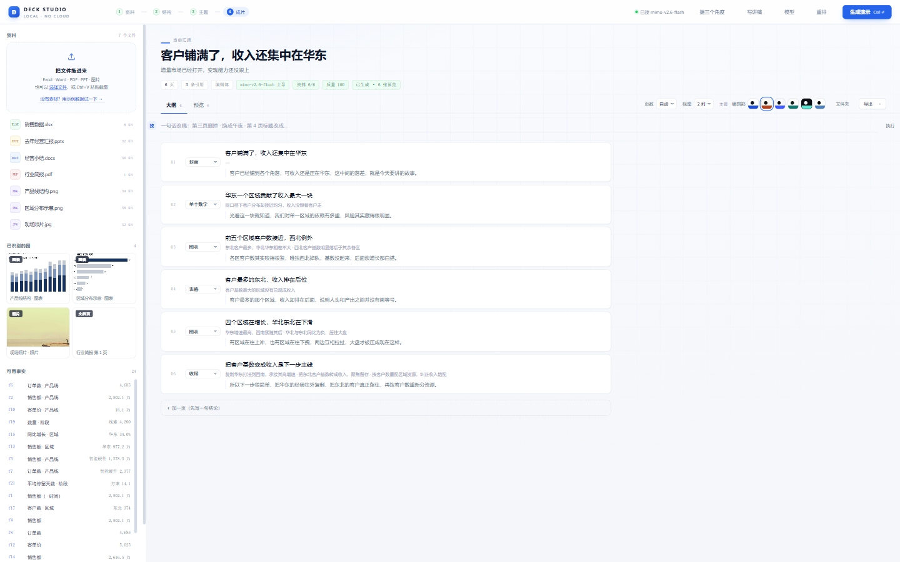
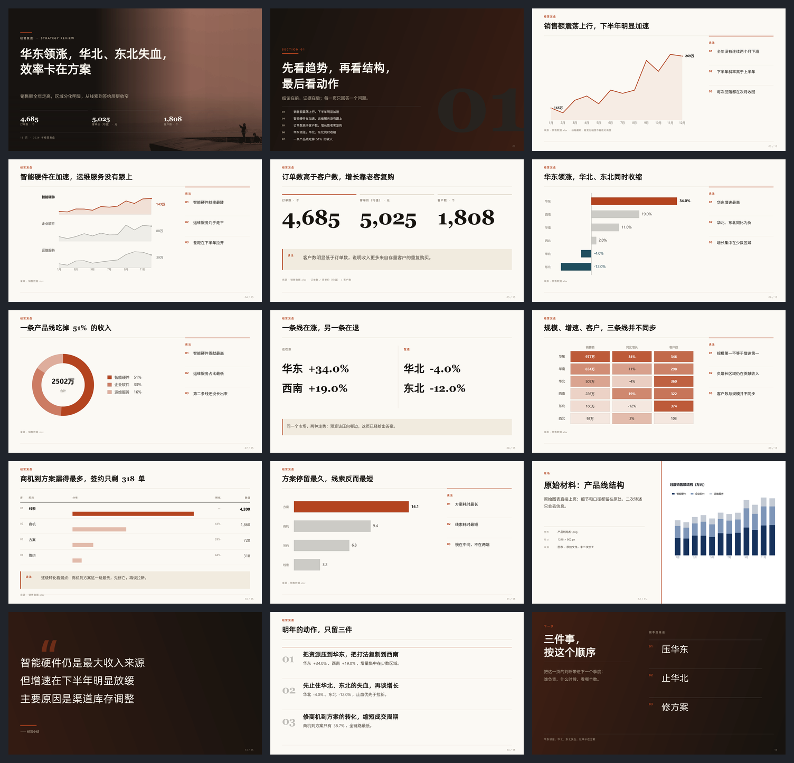

# Deck Studio

[](https://github.com/maquekenzhegua/deck-studio/actions/workflows/ci.yml)
[](https://github.com/maquekenzhegua/deck-studio/releases/latest)
[](LICENSE)

把一堆工作文件（Excel、Word、PDF、旧 PPT、截图、照片）变成一份**不会说谎、也拿得出手**的汇报 PPT。

不是一个套模板的「一键生成」。它先把你手上的材料读懂、算清楚，再按一套从 19 份真实 deck（1144 页）里量出来的设计规范排版；模型可以主导论证，但**任何一个数字都必须能指回原始表格**。

> **下载即用**：[Deck Studio 0.8.0 · Windows x64](https://github.com/maquekenzhegua/deck-studio/releases/latest) — 解压后双击 `Deck Studio.exe`，不需要装 Python。没有 Office 也能预览（内置 LibreOffice 无头转换）。



---

## 它能做什么

| 能力 | 说明 |
|---|---|
| 多模态输入 | xlsx / xlsm / csv / docx / pdf / pptx / png / jpg / webp，混着拖进来就行 |
| 没有数字也能出 | 只有文档就出「结论 + 原文摘录」；只有图片就出「封面 + 现场页 + 收尾」，不编图表、不编数字 |
| 真的会算 | 从表里抽事实：趋势、区域/产品构成、同比、漏斗、停留；比率用均值，漏斗找瓶颈 |
| 数字可追溯 | 每页数字渲染前逐项校验，对不上就拦下来（`deck/verify.py`） |
| 版式自己选 | 封面 / 章节 / 单个数字 / 关键数 / 图表 / 表格 / 对比 / 要点 / 引语 / 图文 / 全幅图 / 收尾 |
| 双指标对照 | 表格里「客户数」和「销售额」并排：「东北客户数第一、销售额第五」这句话，读者能在同一页核对 |
| 图表不止柱状图 | 折线（带峰值）、条形、分面小图、环形占比、增量瀑布、热力记分卡、双指标表格 |
| 读懂图 | 图片先分类（图表/截图/文档页/照片），PDF 里的**带线表格读成数值**（`1,278`→1278，百分比按表头判断），PDF 也渲染成页图，DOCX 抽内嵌图，PPTX 读配色/字体/标题字号 |
| 学你的模板 | 上传一份旧 PPT，它把配色、字体、标题字号映射成第 6 个主题「你的模板」 |
| 模型主导 | 配上任意 OpenAI 兼容模型，由它决定页序、选哪条事实、标题怎么写；程序只当裁判 |
| 自查 | 模型写完先自己过一遍：标题只有数字、图表没绑事实、四行要点，会在交付前改掉；改坏了数字就保留原稿 |
| 评审 | 渲染前通读大纲：标题只有数字、图表页没绑事实、连续三页同一版式都会指出来；一句「按评审意见改」交给模型重写 |
| 一句话改稿 | 「第三页删掉」「换成午夜」「第 4 页标题改成…」直接在界面上改并重排 |
| 导出 | PPTX（可编辑）/ PDF / 每页 PNG，一键到桌面 |

没有数字的纯文档也能出稿：它会挑出原文里最像结论的几句话，做一份摘录页 + 引语页，而不是硬编图表。

评审不是打分，是改稿入口：右下角列出问题，点「让模型按意见改」，它带着问题清单重排一版，数字仍然逐个校验。





## 两条入口

**桌面版（推荐）**——双击 `Deck Studio.exe`，左边拖文件，中间改标题和顺序，右边看渲染结果。
工具栏最左边的「页数」决定模型排页序的深度：自动按资料量估算，也可以钉死 6 / 9 / 12 页。

```bash
python run_app.py            # 源码启动（Win10/11 自带 WebView2）
```

**命令行**——适合批处理和进流水线：

```bash
python -m deck.cli facts  samples/data                 # 看看抽出了哪些事实
python -m deck.cli build  samples/data --theme editorial --out out/deck.pptx
python -m deck.cli audit  out/deck.pptx                # 设计规则体检
```

`--offline` 强制不调用模型；不填任何 Key 时默认就是离线。

## 装上模型（可选）

界面右上角 **模型** → 选预设 → 填 Key → **测试连接** → 保存。不用改环境变量、不用重启。



内置预设：DeepSeek、通义千问（DashScope）、智谱 GLM、Moonshot、豆包（方舟）、百川智能、MiniMax、SiliconFlow、OpenAI、本机 Ollama。切换只改这一个面板，不碰环境变量。
视觉模型单独一栏，留空就沿用文本模型的地址与 Key；只有显式填了视觉模型，界面才会显示「可读图」。

- 文本模型走 `deck/llm.py`（任意 OpenAI 兼容 `/chat/completions`），视觉走 `deck/vision.py`。
- Key 只存在本机 `~/Documents/Deck Studio/settings.json`，回显打码。
- 环境变量 `DECK_BASE_URL / DECK_API_KEY / DECK_MODEL`、`DECK_VISION_*` 优先级更高，方便 CI 或临时覆盖。
- 测试连接会真发一次 `max_tokens=1` 的请求；401/404 原样报给你，不会假装成功。

模型主导是怎么运作的（`deck/agent.py`，细节见 [docs/model-led.md](docs/model-led.md)）：

0. **先提角度**：右上「提三个角度」→ `POST /api/ideas`，模型读事实清单，给三个不同叙事角度，每个注明靠哪几条事实站得住；选一个，整份大纲按它重排。同一个材料可以讲成不同的故事，这一步把选择权交回给人。



1. 模型拿到事实清单、图片清单、版式清单，写出完整大纲（页序、每页论点、绑定哪条事实、要不要用环形/分面/热力）；
2. `verify.py` 检查每个数字能否指回事实——**模型不许自己写数字**；
3. 有问题就把问题清单发回模型修一次；只修得动版式的建议不会推翻整份稿子；
4. 数字仍然对不上，才退回离线规划，并在界面上说明原因。



实测（本机端点 `mimo-v2.6-flash`，约 28 token/s）：7 页大纲 2–5 分钟，改稿 15→14 页 36 秒。
界面会实时显示已等秒数；超时自动缩到 5 页重试一次，两次都超时才退回离线，并说明原因——
不会让你对着一个转圈的空窗口等十分钟。

**讲稿**：右上「写讲稿」让模型按每页论点写一句现场说的话（`POST /api/notes`），
写进 PPTX 的演讲者备注——上场前不用重新组织语言。讲稿里不许出现数字：
一句话里混进编造的百分比，比没有讲稿更糟，所以带数字的句子整条丢弃。



「一句话改稿」也归模型管：配了模型时，它可以按「把结论提前、删掉表格、第 3 页换成对比」
这类开放式指令重写大纲；没配模型时仍由规则编辑器处理「第三页删掉」「换成午夜」这些明确命令。
两条路都过同一套校验——改稿里编出来的数字，整份改稿会被打回，而不是悄悄留下一页。

## 预览图怎么来的

优先调用本机 **LibreOffice**（`soffice --headless` 转 PDF，再用 PyMuPDF 逐页渲染成 PNG）；
没有 LibreOffice 才退回 PowerPoint COM（机器上只装 WPS 时 COM 会不稳）；两条路都没有时 PPTX 照常写出，只是不给逐页预览。

## 设计不是拍脑袋

`docs/design-language.md` 记录了量出来的东西，而不是「我觉得好看」：

- 19 份 Fortune 500 真实 deck、1144 页缩略图；深色页 207、浅色 937，墨迹率中位数 28.6%；
- 封面/章节页几乎都是整版品牌色或全出血照片，字号 40–60pt；
- 浅色内容页靠强网格、卡片、图表把版面填满——所以「空」不是高级，是没做完；
- 深浅交替制造节奏；页码、logo、章节标签一律极简。

渲染器里每一条反模式都对应一次实拍返工：幽灵元素、单位漂移、42% 基线错位、正负同色、压平趋势、把图表当照片、一页三个焦点。
`tools/qa.py` 会把成稿再量一遍（墨迹率、字号、出血、连续同版式），界面上的「质量 100」就是它给的。



## 安装与打包

```bash
python -m pip install -r requirements.txt
python run_app.py
```

打包成独立程序（one-folder，不依赖本机 Python）：

```bash
python -m PyInstaller deck_studio.spec --noconfirm --clean
# 产物：dist/Deck Studio/Deck Studio.exe
```

打包前先关掉正在运行的实例，否则 `_internal` 里的 dll 被占用会报 `PermissionError`。

无头冒烟（不打开窗口，适合 CI）：

```bash
DECK_HEADLESS=1 DECK_PORT=8799 "dist/Deck Studio/Deck Studio.exe"
curl -s http://127.0.0.1:8799/health
```

## 验收

一条命令，从一份空工作区走到一套成稿（上传 7 个文件 → 24 条事实 → 15 页 → 导出 PDF）：

```bash
python tools/accept.py
```

最近一次输出与说明见 [docs/acceptance.md](docs/acceptance.md)：9 项检查全过、质量分 100、数字问题 0。

## 测试

```bash
python -m unittest discover -s tests
```

217 条离线测试：数字校验、离线规划、版式与图表、模型主导的降级路径、模型自查、多模态分类、PDF/Excel 原生图表、模板配色、QA 阈值、HTTP 接口、一句话改稿。
没有网络、没有模型、没有 Office 也能全绿。

## 目录

```
deck/
  ingest.py      读文件：表格/文档/PDF/图片/旧 PPT
  multimodal.py  图片分类、PDF 页图、DOCX 内嵌图、PPTX 配色与字号
  compute.py     从表算事实（趋势/构成/同比/漏斗/停留/多系列）
  compose.py     离线规划：没有模型也能出稿
  agent.py       模型主导 + 校验 + 一次修订 + 降级
  plan.py        大纲结构与约束（标题必须是判断句）
  verify.py      数字与结构校验
  visual.py      主题、字号、图片处理（双色调、遮罩、裁白边）
  render2.py     12 种版式，逐像素排版
  charts2.py     折线/条形/分面/环形/热力图
  audit.py rules.py  设计规则体检
app/
  server.py      FastAPI：上传、规划、生成、导出、设置
  desktop.py     pywebview 窗口（WebView2）
  static/        亮色界面（单页 + 一份 CSS）
tools/
  preview.py     LibreOffice/COM → PNG/PDF
  qa.py          成稿质量分
samples/data/    示例：销售表、经营小结、行业简报、旧 PPT、截图、照片
```

## 边界

- 模板只学配色、字体、标题字号，不复制别人的版式几何；
- 语义读图需要视觉模型，没配就只用几何与配色特征（不联网也能判「图表 / 照片 / 文档页」）；
- 生成以规则为主：接模型会更会写句子、更会挑页，但不会替你编数据；
- 目前只针对 16:9；导出 PDF/PNG 依赖本机 LibreOffice 或 Office。

## License

MIT
